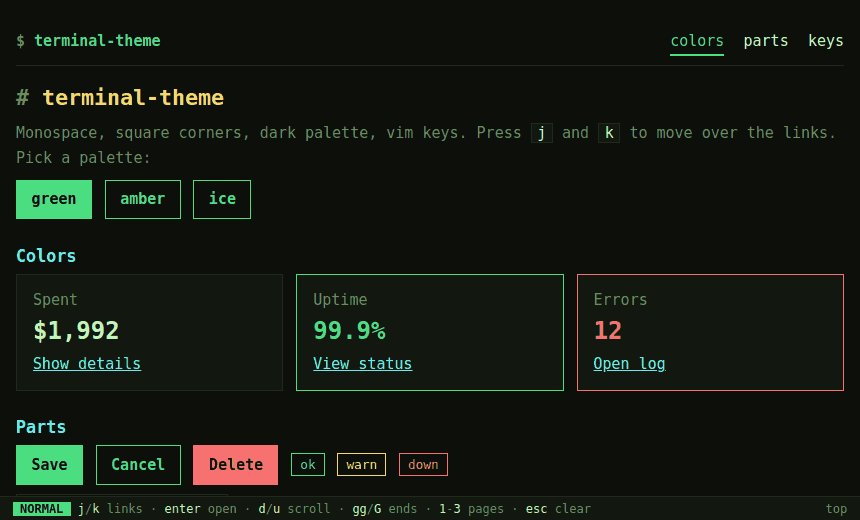
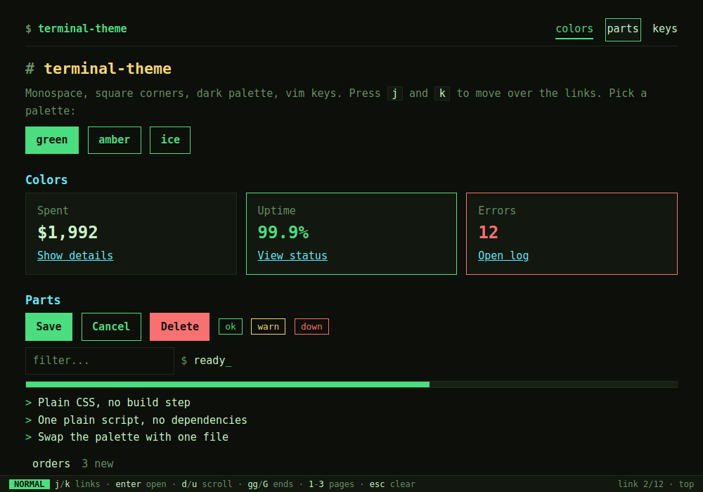
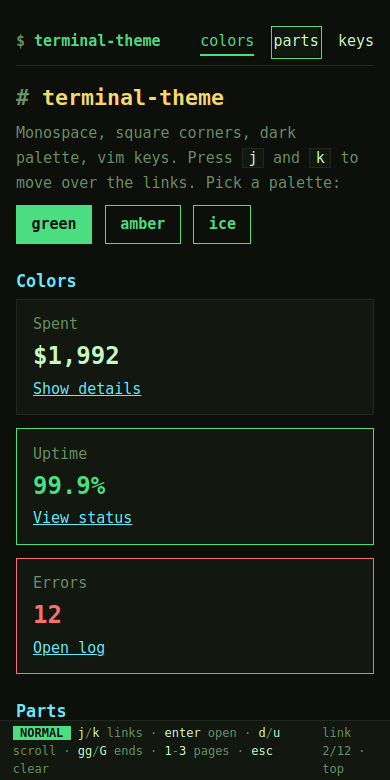

# terminal-theme

A terminal look for any web page: monospace, square corners, a dark green-on-black palette, and vim-style keys. Plain CSS and one plain script. No build step, no dependencies, about 13 KB (4.5 KB gzipped) for everything.



<!-- Live demo: add the link here once it is on the personal site. -->
Try it locally: open `demo.html` and press `j` / `k`.

<p>
  
  
</p>

## What is in it

| File | Job | Use it when |
|---|---|---|
| `terminal.css` | Tokens (`--t-*`), square corners, selection, status line, highlight style | Always. This is the core. |
| `base.css` | Styles for plain elements: body, headings, links, tables, code, inputs, buttons | A new page with no CSS of its own |
| `components.css` | Opt-in `t-*` classes: boxes, grid, buttons, tags, nav, list, bar, prompt | You want ready-made parts |
| `all.css` | Imports the three files above | The simplest start |
| `terminal-keys.js` | Vim-style keys and a status line | You want keyboard navigation |
| `themes/*.css` | Other palettes (`amber`, `ice`) | You want a different colour |

Pick what you need. Each file works alone, except that all CSS files need `terminal.css` first.

## Install

Pick one.

**CDN** (no install):

```html
<link rel="stylesheet" href="https://cdn.jsdelivr.net/gh/rzhou404/terminal-theme@v1.0.0/all.css">
<script src="https://cdn.jsdelivr.net/gh/rzhou404/terminal-theme@v1.0.0/terminal-keys.js"
        data-links="main a[href]"></script>
```

**npm** (from GitHub, pinned to a tag):

```
npm i github:rzhou404/terminal-theme#v1.0.0
```

```css
@import "terminal-theme/all.css";
```

```js
import "terminal-theme/keys";   // adds window.TerminalKeys
```

**Copy the files**: they are small and have no dependencies. Copy `terminal.css` (and `base.css`, `components.css`, `terminal-keys.js` if you use them) into your project. `sync.sh <app-dir> <css-dest> [js-dest]` does this for you and stamps the version in a comment.

Pin a tag (`v1.0.0`), not `main`, so a later change never surprises you.

## Recipes

### Plain HTML

```html
<!doctype html>
<meta charset="utf-8">
<meta name="viewport" content="width=device-width,initial-scale=1">
<link rel="stylesheet" href="all.css">
<body>
  <main class="t-page">
    <h1 class="t-h1">hello</h1>
    <p><a href="/docs">docs</a> · <a href="/about">about</a></p>
  </main>
  <script src="terminal-keys.js" data-links="main a[href]" data-pages="/,/docs,/about"></script>
</body>
```

### Next.js (app router)

```tsx
// app/layout.tsx
import "terminal-theme/all.css";
import Script from "next/script";

export default function Layout({ children }: { children: React.ReactNode }) {
  return (
    <html lang="en">
      <body>
        {children}
        <Script src="/terminal-keys.js" strategy="afterInteractive" data-links="main a[href]" />
      </body>
    </html>
  );
}
```

Copy `node_modules/terminal-theme/terminal-keys.js` to `public/` (a `postinstall` script can do it). If the app lives under a base path, prefix the `src`.

### Astro

```astro
---
import "terminal-theme/all.css";
---
<slot />
<script is:inline src="/terminal-keys.js" data-links="main a[href]"></script>
```

### Vite, React, Vue, Svelte

```js
import "terminal-theme/all.css";
import "terminal-theme/keys";

TerminalKeys.init({ links: "main a[href]", pages: ["/", "/about"] });
```

Call `init` once after mount. It returns `{ destroy() }`; call that when the view unmounts.

### Static page generators (Python, Hugo, Jekyll, anything)

Inline the CSS and script into each page so every page is a single file:

```python
css = open("all.css").read()      # or concatenate terminal.css + base.css + components.css
js = open("terminal-keys.js").read()
page = f"<style>{css}</style><body>...</body><script>{js}</script><script>TerminalKeys.init({{links:'a[href]'}})</script>"
```

If you inline `all.css`, concatenate its three files instead (an inlined `@import` cannot find them).

### An app that already has its own CSS

Load only `terminal.css`, then point your own colour names at the tokens:

```css
:root {
  --bg: var(--t-bg);
  --text: var(--t-fg);
  --muted: var(--t-dim);
  --border: var(--t-line);
  --accent: var(--t-grn);
  --danger: var(--t-red);
}
```

Your component CSS keeps working and takes the palette. Square corners apply to everything.

## Tokens

| Token | Default | Meaning |
|---|---|---|
| `--t-bg` | `#0c0f0a` | page background |
| `--t-bg2` | `#121810` | raised surface (cards, code) |
| `--t-bg3` | `#182014` | second raised surface |
| `--t-fg` | `#c8f7c5` | body text |
| `--t-dim` | `#6b8f66` | muted text |
| `--t-line` | `#1f2a1c` | borders |
| `--t-grn` | `#4ade80` | accent, ok |
| `--t-yel` | `#f5d76e` | headings, warn |
| `--t-cyan` | `#67e8f9` | links, info |
| `--t-red` | `#f87171` | error |
| `--t-mag` | `#f0abfc` | extra |
| `--t-font` | monospace stack | font family |

## Components

| Class | What it is |
|---|---|
| `t-page`, `t-page--narrow` | centred page column |
| `t-grid`, `t-row` | responsive grid, wrapping row |
| `t-box` (`--ok`, `--warn`, `--bad`) | bordered card |
| `t-btn` (`--ghost`, `--bad`) | button or link styled as a button |
| `t-input` | text field |
| `t-tag` (`--ok`, `--warn`, `--bad`) | small label |
| `t-nav`, `t-brand` | top bar; mark the current page with `aria-current="page"` |
| `t-list` | list with `>` bullets |
| `t-linkrow` | clickable row |
| `t-bar` | progress bar: `<div class="t-bar"><i style="width:40%"></i></div>` |
| `t-prompt`, `t-cursor` | `$ ` prefix, blinking `_` |
| `t-h1`, `t-h2` | `# ` and `## ` heading prefix |
| `t-muted`, `t-ok`, `t-warn`, `t-bad`, `t-info`, `t-big` | text colour and size helpers |
| `t-kbd` | keyboard hint |

`demo.html` shows every one of them.

## Keys

| Key | Does |
|---|---|
| `j` / `k`, arrows | move the highlight over links |
| `Enter`, `l` | open the highlighted link |
| `o` | open it in a new tab |
| `d` / `u` | half page down / up |
| `gg` / `G` | top / bottom |
| `1`-`9` | go to the matching entry in `pages` |
| `q`, `h` | go to `home` (when set) |
| `Esc` | clear the highlight |

Keys are ignored while you type in a field and when Ctrl, Alt or Cmd is held, so browser shortcuts still work. `Enter` keeps its normal job on a focused button unless a link is highlighted.

```js
const keys = TerminalKeys.init({
  links: "main a[href]",     // which links j/k visit
  pages: ["/", "/about"],    // keys 1, 2
  home: "/",                 // q and h
  statusLine: true,          // the bar at the bottom
  selectedClass: "kb-sel",   // class on the highlighted link
});
keys.destroy();              // remove listeners and the bar
```

You can also set `data-links`, `data-pages` and `data-home` on the script tag. The status line is hidden on touch screens. On a phone with a fixed bottom bar of your own, pass `statusLine: false`.

## Change the palette

Load a file from `themes/` after `terminal.css`:

```html
<link rel="stylesheet" href="themes/amber.css">
```

Or write your own: override the `--t-*` tokens.

```css
:root { --t-bg: #000; --t-fg: #fff; --t-grn: #ff0066; }
```

Every file uses the tokens, so one override restyles everything.

## Good to know

- **Dark only.** There is no light mode on purpose.
- **Square corners are forced** with `border-radius: 0 !important` so they apply to existing components. If you need one round element, remove that rule from `terminal.css` in your copy.
- **Contrast.** Muted text (`--t-dim`) on the page background measures 4.7:1 to 5.3:1 across the three palettes, just above the 4.5:1 minimum for body text. Do not go dimmer for text people must read.
- **Motion.** The only animation (`t-cursor`) stops when the visitor asks for reduced motion.
- **Focus.** Keyboard focus is always visible.

## Regenerate the previews

Open `demo.html` at 860 px wide, press `j` four times, then click each palette button, and capture the frames. `docs/desktop.png` is 1000 px wide and `docs/phone.png` is 390 px wide, each after pressing `j` twice. Any screenshot tool and any GIF encoder works.

## Contributing

Keep it dependency-free and keep each file usable alone. Add a class to `components.css` only if it works from the tokens alone, show it in `demo.html`, and list it in the Components table.

## License

MIT. See `LICENSE`.
